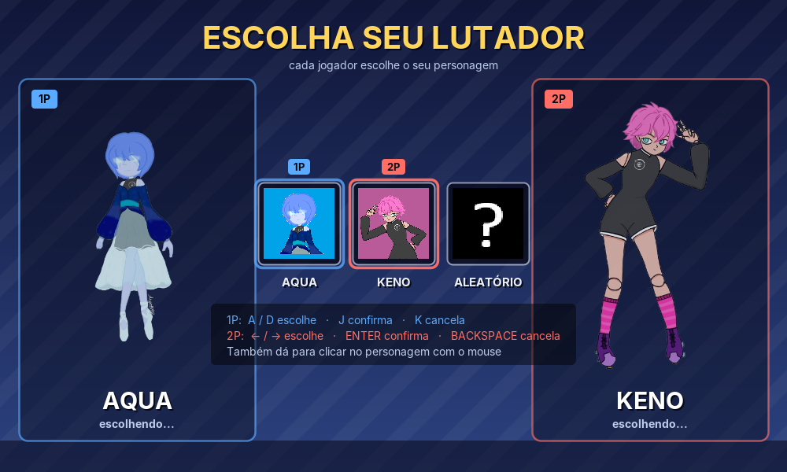
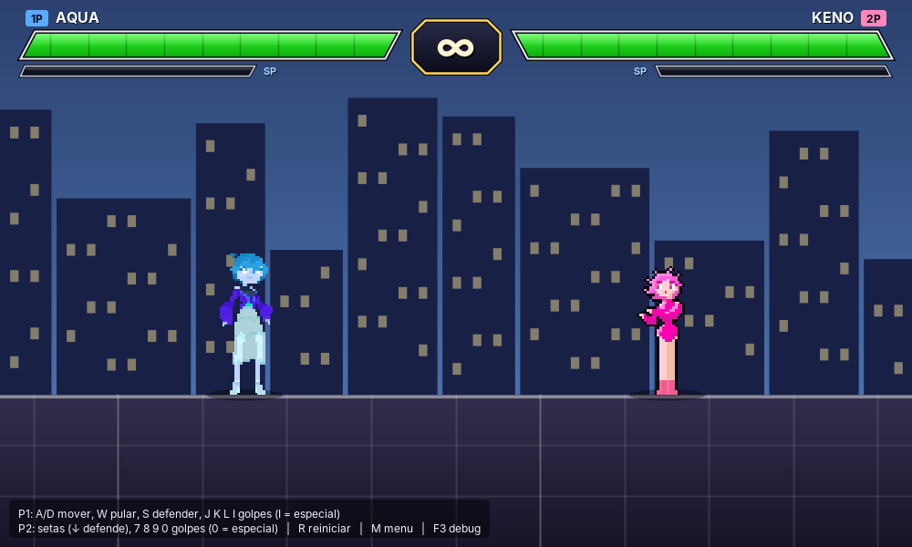
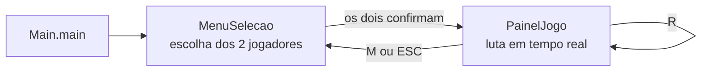
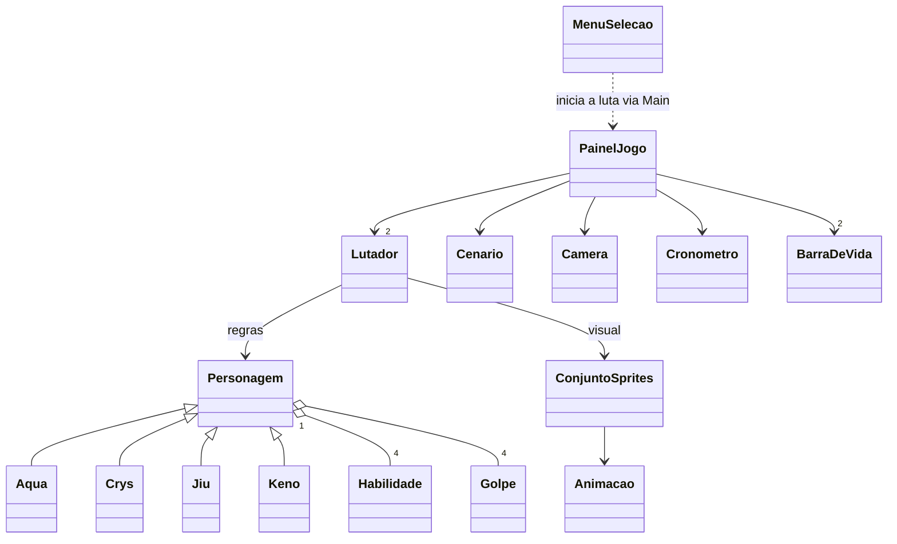

# 🥊 Clube da Luta

Jogo de luta 2D para dois jogadores, feito em **Java puro** (Swing e AWT), sem bibliotecas externas.
Os dois jogadores escolhem um lutador, enfrentam-se na mesma tela e vence quem derrubar o adversário primeiro (K.O.).

O projeto tem foco em estudo: mostra como montar um *game loop*, colisão com hitbox, câmera com zoom, animação por sprites e uma
separação clara entre **regras do jogo** e **parte visual**.

| Menu de seleção | Luta |
|:---:|:---:|
|  |  |

---

## Sumário

1. [Como iniciar o jogo](#1-como-iniciar-o-jogo)
2. [Controles](#2-controles)
3. [Como jogar (regras)](#3-como-jogar-regras)
4. [Personagens e golpes](#4-personagens-e-golpes)
5. [Estrutura do projeto](#5-estrutura-do-projeto)
6. [Como o código funciona](#6-como-o-código-funciona)
7. [Documentação das classes](#7-documentação-das-classes)
8. [Assets (sprites)](#8-assets-sprites)
9. [Como adicionar um personagem novo](#9-como-adicionar-um-personagem-novo)
10. [Solução de problemas](#10-solução-de-problemas)
11. [Limitações conhecidas e melhorias futuras](#11-limitações-conhecidas-e-melhorias-futuras)
12. [Autor](#12-autor)

---

## 1. Como iniciar o jogo

### Requisitos

- **JDK 21** (o projeto foi desenvolvido com o Amazon Corretto 21). O código usa recursos do Java 11 em diante, como `String.isBlank()`.
- Um computador com **tela** (o jogo abre uma janela Swing; não roda em terminal sem interface gráfica).
- Um **teclado**. Os dois jogadores jogam no mesmo teclado.

Para conferir se o JDK está instalado, rode `java -version` e `javac -version` no terminal. Os dois precisam responder.

### Opção A: pelo IntelliJ IDEA (mais simples)

1. Abra o IntelliJ e use **File → Open**, escolhendo a pasta `ClubeDaLuta`.
2. Confirme que a pasta `src` está marcada como **Sources Root** (ícone azul). Se não estiver: clique com o botão direito em `src` → **Mark Directory as → Sources Root**.
3. Em **File → Project Structure → Project**, escolha um **JDK 21** como SDK do projeto.
4. Abra o arquivo `src/Luta/Main.java`.
5. Clique no triângulo verde ▶ ao lado de `public class Main` (ou aperte `Shift + F10`).

A janela **Clube da Luta** abre no menu de seleção de personagem.

### Opção B: pelo terminal

Entre na pasta do projeto (a que contém `src/`) e rode:

**Linux, macOS ou Git Bash**

```bash
# 1) compilar (gera os .class dentro da pasta out)
javac -encoding UTF-8 -d out $(find src -name "*.java")

# 2) executar (src entra no classpath porque os sprites ficam em src/assets)
java -cp "out:src" Luta.Main
```

**Windows (PowerShell)**

```powershell
# 1) compilar
javac -encoding UTF-8 -d out (Get-ChildItem -Path src -Recurse -Filter *.java).FullName

# 2) executar (no Windows o separador do classpath é ponto e vírgula)
java -cp "out;src" Luta.Main
```

> **Por que `src` também está no classpath?** Os sprites são lidos com `getResource("/assets/...")`, ou seja, precisam estar no classpath.
> O IntelliJ copia a pasta `assets` automaticamente para `out/`; no terminal, incluir `src` no classpath resolve o mesmo problema.

### O que acontece ao abrir

1. Abre o **menu de seleção** (janela de 1000 x 600).
2. Cada jogador move o cursor e confirma o seu lutador (veja [Controles](#2-controles)).
3. Quando os dois confirmam, aparece o texto **LUTAR!** e, depois de cerca de 1 segundo, começa a **luta**.
4. Na luta, `M` ou `ESC` voltam ao menu e `R` reinicia a luta.

---

## 2. Controles

### Menu de seleção

| Ação | Jogador 1 | Jogador 2 |
|---|---|---|
| Mover o cursor | `A` / `D` | `←` / `→` |
| Confirmar personagem | `J` | `Enter`, `7` ou `Numpad 1` |
| Cancelar (para trocar a escolha) | `K` | `Backspace`, `8` ou `Numpad 2` |

O **mouse** também funciona: o 1º clique em um personagem vale para o jogador 1 e o 2º clique vale para o jogador 2.
O último cartão (**?**) é o **Aleatório**: sorteia um personagem entre os disponíveis na hora de começar a luta.
Os dois jogadores podem escolher o mesmo personagem.

### Luta

| Ação | Jogador 1 | Jogador 2 |
|---|---|---|
| Andar | `A` / `D` | `←` / `→` |
| Pular | `W` | `↑` |
| Defender (segurar) | `S` | `↓` |
| Golpe 1 (leve) | `J` | `7` ou `Numpad 1` |
| Golpe 2 (médio) | `K` | `8` ou `Numpad 2` |
| Golpe 3 (forte) | `L` | `9` ou `Numpad 3` |
| Golpe 4 (**especial**) | `I` | `0` ou `Numpad 4` |

| Tecla | Função (vale para os dois) |
|---|---|
| `R` | Reinicia a luta (vida cheia, mesmas posições) |
| `M` ou `ESC` | Volta ao menu de seleção |
| `F3` | Liga/desliga o **modo debug** (hitboxes, zoom, FPS e posições) |

Uma legenda com esses controles também aparece no canto inferior esquerdo da tela de luta.

---

## 3. Como jogar (regras)

- **Objetivo:** zerar a vida do adversário. Quando isso acontece, aparece **K.O.!** e o vencedor (`1P VENCEU`, `2P VENCEU` ou `EMPATE`). Aperte `R` para jogar de novo.
- **Tempo:** o cronômetro é **infinito** (mostra ∞). Não existe vitória por tempo.
- **Golpes 1 a 3:** causam dano e **carregam a barra de especial** de quem bateu (o ganho varia por golpe).
- **Especial (golpe 4):** só pode ser usado com a barra de especial **cheia** (100). O custo é gasto **quando o golpe acerta**; se errar, a barra não é consumida.
- **Defesa:** segure a tecla de defesa **no chão**. O dano recebido cai pela metade (arredondado para baixo, mínimo 1) e o empurrão e o atordoamento são menores. Enquanto defende, o lutador não anda, não pula e não golpeia.
- **Golpe:** tem 3 fases e acerta **no máximo uma vez** por execução (veja abaixo).
- **Atordoamento:** quem leva um golpe fica sem agir por 0,30 s (0,12 s se estava defendendo) e é empurrado para trás.
- **Colisão entre lutadores:** um não atravessa o outro. Dá para **pousar na cabeça** do adversário.
- **Palco:** os lutadores não passam das paredes do cenário.
- O lutador **olha sempre para o adversário**, exceto durante um golpe.

### Fases de um golpe

```
 [ início ][  ativo  ][ recuperação ]
  prepara    hitbox     fica parado
  (não       existe e   até poder
  acerta)    pode       agir de novo
             acertar
```

A **hitbox** é um retângulo à frente do lutador (`alcance` x `altura`). Para acertar, ela precisa encostar na **hurtbox**, a caixa do corpo do adversário.
Ative o `F3` para ver as duas caixas em tempo real (vermelha = corpo, laranja = golpe).

---

## 4. Personagens e golpes

| Personagem | Estilo | Vida | Especial máx. | Velocidade | Força do pulo | Jogável na luta em tempo real |
|---|---|:---:|:---:|:---:|:---:|:---:|
| **Aqua** | Mago: maior alcance, mas lento e demora para golpear | 275 | 100 | 380 | 1100 | ✅ |
| **Keno** | Ágil: o mais rápido e o que pula mais alto | 275 | 100 | 480 | 1250 | ✅ |
| **Crys** | Lutador: alcance curto, golpes rápidos e muita vida | 310 | 100 | 440 | 1100 | ⏳ sem sprites ainda |
| **Jiu** | Espadachim: alcance médio-longo, golpes pesados | 290 | 100 | 400 | 1050 | ⏳ sem sprites ainda |

> Crys e Jiu já existem como classes com todas as regras, mas ainda não têm sprites. Por isso ainda não aparecem no menu de seleção.

Velocidade em unidades do mundo por segundo. Tempos em segundos. **Ganho** = quanto o golpe carrega de especial ao acertar; **Custo** = quanto o golpe gasta.

### Aqua

| # | Golpe | Dano | Custo | Ganho | Alcance | Início / Ativo / Recup. | Empurrão |
|:-:|---|:-:|:-:|:-:|:-:|:-:|:-:|
| 1 | arco d'água | 10 | 0 | 25 | 115 | 0,09 / 0,08 / 0,20 | 260 |
| 2 | dois arcos d'água | 14 | 0 | 30 | 145 | 0,12 / 0,10 / 0,24 | 330 |
| 3 | lâmina d'água | 19 | 0 | 35 | 185 | 0,16 / 0,12 / 0,30 | 430 |
| 4 | **tsunami** (especial) | 50 | 100 | 0 | 380 | 0,34 / 0,25 / 0,50 | 800 |

### Keno

| # | Golpe | Dano | Custo | Ganho | Alcance | Início / Ativo / Recup. | Empurrão |
|:-:|---|:-:|:-:|:-:|:-:|:-:|:-:|
| 1 | Chute | 9 | 0 | 25 | 85 | 0,07 / 0,07 / 0,16 | 260 |
| 2 | Chute Duplo | 12 | 0 | 30 | 110 | 0,09 / 0,09 / 0,20 | 330 |
| 3 | Pulo e chute | 16 | 0 | 35 | 140 | 0,12 / 0,12 / 0,26 | 430 |
| 4 | **Pula bem alto e chuta por cima** (especial) | 38 | 100 | 0 | 270 | 0,26 / 0,22 / 0,42 | 800 |

### Crys

| # | Golpe | Dano | Custo | Ganho | Alcance | Início / Ativo / Recup. | Empurrão |
|:-:|---|:-:|:-:|:-:|:-:|:-:|:-:|
| 1 | murro | 9 | 0 | 15 | 80 | 0,06 / 0,08 / 0,17 | 240 |
| 2 | garras | 13 | 0 | 20 | 100 | 0,09 / 0,10 / 0,21 | 320 |
| 3 | soco fortificado | 17 | 0 | 25 | 125 | 0,13 / 0,12 / 0,27 | 460 |
| 4 | **enchurrada de socos** (especial) | 38 | 100 | 0 | 240 | 0,28 / 0,25 / 0,45 | 800 |

### Jiu

| # | Golpe | Dano | Custo | Ganho | Alcance | Início / Ativo / Recup. | Empurrão |
|:-:|---|:-:|:-:|:-:|:-:|:-:|:-:|
| 1 | Estocada | 11 | 0 | 15 | 105 | 0,08 / 0,08 / 0,19 | 260 |
| 2 | Arremesso | 15 | 0 | 20 | 135 | 0,11 / 0,10 / 0,23 | 330 |
| 3 | Ataque Cruzado | 19 | 0 | 25 | 170 | 0,15 / 0,12 / 0,30 | 430 |
| 4 | **Claymore** (especial) | 46 | 100 | 0 | 320 | 0,32 / 0,25 / 0,48 | 800 |

---

## 5. Estrutura do projeto

```
ClubeDaLuta/
├── src/
│   ├── Luta/
│   │   ├── Main.java                 ← PONTO DE ENTRADA do jogo em tempo real
│   │   ├── Jogo/                     ← motor do jogo: tela, física, câmera, animação
│   │   │   ├── MenuSelecao.java
│   │   │   ├── PainelJogo.java
│   │   │   ├── Lutador.java
│   │   │   ├── Golpe.java
│   │   │   ├── ConjuntoSprites.java
│   │   │   ├── Animacao.java
│   │   │   ├── Camera.java
│   │   │   ├── Cenario.java
│   │   │   ├── BarraDeVida.java
│   │   │   └── Cronometro.java
│   │   ├── Personagem/               ← regras genéricas de um personagem
│   │   │   ├── Personagem.java       (classe abstrata)
│   │   │   └── Habilidade.java
│   │   └── Personagens/              ← os lutadores de verdade
│   │       ├── Aqua.java
│   │       ├── Crys.java
│   │       ├── Jiu.java
│   │       └── Keno.java
│   └── assets/                       ← sprites PNG (precisa ficar DENTRO de src)
│       ├── aqua/
│       ├── keno/
│       └── randomizer_icon.png
├── docs/                             ← imagens usadas neste README
└── README.md
```

A pasta `out/` (arquivos compilados) e a `.idea/` (configuração do IntelliJ) são geradas pela IDE e **não** fazem parte do código-fonte.

---

## 6. Como o código funciona

### Ideia central: separar "regra" de "visual"

| Quem | Cuida de | Exemplos |
|---|---|---|
| `Personagem` (e subclasses) | **Regras** | vida, especial, dano, defesa, habilidades |
| `Lutador` | **Visual e física** | posição, pulo, colisão, hitbox, animação |

Assim dá para trocar a parte visual sem mexer nas regras.

### Fluxo das telas



O `Main` usa **uma única janela** (`JFrame`) e só troca o painel de dentro (`setContentPane`). As telas se comunicam por *callbacks*:
o menu recebe uma função que é chamada quando os dois escolhem, e a luta recebe outra função para voltar ao menu.

### Relação entre as classes



### O *game loop* (`PainelJogo`)

Um `javax.swing.Timer` dispara **cerca de 60 vezes por segundo** (a cada 1000/60 ms). A cada disparo:

1. Calcula o **`dt`**, o tempo desde o último quadro em segundos, limitado a 0,05 s para evitar "saltos" se o jogo travar.
2. Chama `atualizar(dt)`, que:
   - trata teclas de "uma vez só" (`R`, `M`/`ESC`, `F3`);
   - lê as teclas seguradas e converte em direção, pulo, defesa e golpe de cada jogador;
   - atualiza cada `Lutador` (movimento, gravidade, colisões, golpes);
   - move a `Camera` para enquadrar os dois lutadores;
   - atualiza o cronômetro e as barras de vida.
3. Chama `repaint()`, que desenha o **mundo** (cenário + lutadores, passando pela câmera) e depois o **HUD** (barras, timer, legenda), que fica fixo na tela.

Toda a movimentação usa `dt` (por exemplo, `x += velocidade * dt`). Por isso o jogo anda na mesma velocidade independentemente do FPS do computador.

### Teclado: "segurando" x "acabou de apertar"

`PainelJogo` guarda dois conjuntos de teclas:

- **`pressionadas`**: teclas seguradas agora (usadas para andar, pular e defender);
- **`acionadas`**: teclas apertadas **neste quadro** (usadas para golpes e atalhos, para que segurar a tecla não repita o golpe).

O conjunto `acionadas` é limpo ao final de cada `atualizar`. Quando a janela perde o foco, `pressionadas` é limpo para o personagem não ficar andando sozinho.

### Coordenadas e escala

- O palco tem **1800 x 1080** unidades do mundo; o chão fica em `y = 900`. O eixo **y cresce para baixo**.
- A janela tem 1000 x 600 pixels, mas o que aparece depende da **câmera** (posição + zoom).
- Cada pixel do sprite vira **3 x 3** unidades do mundo (`Lutador.ESCALA = 3`).
- A posição `(x, y)` de um lutador é o **ponto dos pés**, no centro do corpo.

---

## 7. Documentação das classes

### Pacote `Luta`

| Classe | Papel |
|---|---|
| **`Main`** | Ponto de entrada. Cria a janela na *thread* de eventos do Swing (`SwingUtilities.invokeLater`), mostra o `MenuSelecao` e troca para o `PainelJogo` quando os dois jogadores escolhem. Se algo falhar ao iniciar (ex.: sprite não encontrado), mostra uma caixa de erro. |

### Pacote `Luta.Personagem` (regras)

**`Personagem`** (classe abstrata): base de todo lutador. Guarda nome, cor, vida, especial, habilidades e a "parte física" (tabela de golpes, velocidade e força do pulo).

| Método | O que faz |
|---|---|
| `adicionarHabilidade(h)` | Registra uma habilidade (máximo de **4**: 3 golpes + 1 especial). Só as subclasses chamam. |
| `usarHabilidade(i, alvo)` | Gasta o especial exigido, causa o dano no alvo e carrega o especial de quem bateu. Retorna o dano real causado (0 se não tiver especial suficiente). |
| `receberDano(d)` | Aplica o dano, reduzido pela metade se estiver defendendo (`max(1, d/2)`). A vida nunca fica abaixo de 0. |
| `defender()` / `iniciarTurno()` | Liga/desliga a guarda. |
| `definirGolpes(...)` / `definirMovimento(vel, pulo)` | Configuram a parte física do personagem (usados nos construtores das subclasses). |
| `getGolpe(i)` | Devolve a tabela do golpe `i` (o índice é limitado entre 0 e 3). |
| `estaVivo()` | `true` enquanto a vida for maior que 0. |

O construtor valida os dados (nome obrigatório, vida maior que 0, especial não negativo) e lança `IllegalArgumentException` se algo estiver errado.
O personagem nasce com **vida cheia** e **especial zerado**.

**`Habilidade`**: dado imutável de um golpe: `nome`, `dano`, `custoEspecial` (quanto gasta) e `ganhoEspecial` (quanto carrega ao acertar). Valores negativos são rejeitados.

### Pacote `Luta.Personagens` (lutadores)

`Aqua`, `Crys`, `Jiu` e `Keno` herdam de `Personagem` e só configuram os dados no construtor: vida, as 4 habilidades, o movimento e a tabela de golpes.
São a referência para criar um personagem novo (veja a [seção 9](#9-como-adicionar-um-personagem-novo)).

### Pacote `Luta.Jogo` (motor)

| Classe | Papel |
|---|---|
| **`MenuSelecao`** | Tela de escolha. Controla o cursor de cada jogador, a confirmação, o cartão **Aleatório** e a contagem antes da luta. Recebe um `Ouvinte` (`lutar(p1, p2)`) para avisar o `Main` quando os dois estão prontos. Trabalha com `Supplier<Personagem>` (uma "fábrica"), assim cada luta nova começa com um personagem novo, de vida cheia. |
| **`PainelJogo`** | O jogo em si: *game loop*, leitura do teclado, desenho do mundo e do HUD, tela de K.O., modo debug e reinício. |
| **`Lutador`** | Um lutador na tela. Cuida de movimento, pulo/gravidade (`GRAVIDADE = 3000`), colisão com paredes e com o adversário, execução de golpes (hitbox x hurtbox), empurrão, atordoamento e escolha do sprite a desenhar. Tem `LARGURA = 60` de hurtbox; a altura vem do personagem. |
| **`Golpe`** | Parte física de um golpe: `inicio`, `ativo`, `recuperacao` (segundos), `alcance`, `altura`, `alturaDoChao` e `empurrao`. `total()` soma as três fases. Tem também uma tabela padrão (`Golpe.de(i)`). |
| **`ConjuntoSprites`** | Todos os sprites de um personagem (parado, golpes, guarda, dano, pulo, K.O., projétil, onda). **Padroniza** cada imagem numa tela de 176 x 72 com os pés sempre em `(48, 64)`, assim o `Lutador` desenha qualquer personagem com a mesma âncora. `carregar(nome)` devolve o conjunto certo; `temSprites(nome)` diz se existe. |
| **`Animacao`** | Sequência de quadros em *loop*. Lê PNGs do classpath com **cache** (cada imagem é lida do disco uma vez só). `getQuadroSincronizado` "estica" os quadros de um golpe para o desenho do ataque aparecer exatamente na fase ativa. |
| **`Camera`** | Câmera dinâmica: enquadra a caixa que contém os dois lutadores, com **zoom suave** (máximo 1,5x) e sem nunca mostrar nada fora do palco. A suavização não depende do FPS. |
| **`Cenario`** | O palco (1800 x 1080): céu, lua, prédios (gerados com semente fixa, então são sempre iguais), chão e marcações. Define as constantes `LARGURA`, `ALTURA`, `CHAO_Y` e `MARGEM_PAREDE`. |
| **`BarraDeVida`** | Barra de vida e de especial do HUD: formato inclinado, cor que vai do verde ao vermelho, **barra fantasma** amarela que desce devagar após um dano e *flash* ao ser atingido. |
| **`Cronometro`** | Timer da luta. Hoje é **infinito** (`Cronometro.infinito()`), mas já existe `Cronometro.contagem(99)` para uma contagem regressiva. |

### Efeitos dos golpes

Cada golpe de `ConjuntoSprites` informa como o efeito visual é desenhado:

| Constante | Significado |
|---|---|
| `EFEITO_CODIGO` | Efeito desenhado por código (arco, lâmina, tsunami), usado quando não há sprite. |
| `EFEITO_NENHUM` | O efeito já faz parte do sprite do personagem. |
| `EFEITO_PROJETIL` | Um sprite que voa para a frente (ex.: lâmina d'água da Aqua). |
| `EFEITO_ONDA` | Sprites de uma onda (tsunami da Aqua). |

---

## 8. Assets (sprites)

Os sprites ficam em `src/assets/` e são carregados pelo caminho `/assets/...` a partir do classpath.
São **47 PNGs** de pixel art.

```
assets/
├── randomizer_icon.png               (cartão "?" do menu)
├── aqua/
│   ├── aqua_icon.png                 (ícone do cartão no menu)
│   ├── aqua_portrait.png             (retrato grande no menu)
│   ├── aqua_guard.png  aqua_hurt.png  aqua_jump.png  aqua_defeated.png
│   ├── idle/            aqua_idle0..5.png       (animação parada, 6 quadros)
│   ├── atack_1/         aqua_atack_1..5.png     (golpe 1 e base dos golpes 2, 3 e 4)
│   ├── atack_3_projectile/  aqua_water_bow.png  (projétil da lâmina d'água)
│   └── special/         aqua_tsunami_1..4.png   (onda do tsunami)
└── keno/
    ├── keno_icon.png  keno_portrait.png
    ├── keno_idle.png  keno_hurt.png  keno_jump.png  keno_defeated.png  keno_special.png
    ├── keno_atack1/     keno_atack0..6.png      (Chute, 7 quadros)
    └── keno_atack2/     keno_double_kick00..09.png  (Chute Duplo, 10 quadros)
```

Os PNGs têm tamanhos diferentes (32x64, 64x64, 128x64) e o personagem não fica no mesmo ponto em todos.
Por isso o `ConjuntoSprites` recebe, para cada personagem, o ponto dos pés na imagem original e recentra tudo na tela padrão.

---

## 9. Como adicionar um personagem novo

Exemplo: criar o personagem **Dragon**.

1. **Regras.** Crie `src/Luta/Personagens/Dragon.java` herdando de `Personagem`, copiando a estrutura de `Aqua.java`: vida, 4 habilidades (`adicionarHabilidade`), `definirMovimento` e `definirGolpes`.
2. **Sprites.** Crie a pasta `src/assets/dragon/` com, no mínimo, `dragon_icon.png` e `dragon_portrait.png` (menu) e os sprites de luta.
3. **Carregamento dos sprites.** Em `ConjuntoSprites`:
   - crie um método `dragon()` parecido com `aqua()` ou `keno()`;
   - inclua `"dragon"` em `temSprites(...)`;
   - inclua um `case "dragon"` no `switch` de `carregar(...)`.
4. **Menu.** Em `MenuSelecao.montarOpcoes()`, acrescente uma linha `opcoes.add(new Opcao("Dragon", Dragon::new, ...))` com o ícone e o retrato.

> Se o personagem entrar no menu sem ter sprites carregados em `ConjuntoSprites`, a luta não consegue começar (veja [Limitações conhecidas](#11-limitações-conhecidas-e-melhorias-futuras)).

---

## 10. Solução de problemas

| Problema | Causa provável e solução |
|---|---|
| `Sprite não encontrado: /assets/...` | A pasta `assets` precisa estar **dentro de `src`** e `src` precisa ser *Sources Root*. No IntelliJ, faça **Build → Rebuild Project**. No terminal, inclua `src` no `-cp`. |
| `javac` ou `java` "não é reconhecido" | O JDK não está instalado ou não está no `PATH`. Instale o JDK 21 e abra um terminal novo. |
| Acentos quebrados ao compilar | Use `javac -encoding UTF-8 ...`. |
| A janela abre mas as teclas não respondem | Clique dentro da janela para dar foco a ela. |
| `HeadlessException` | O ambiente não tem tela (SSH, container, WSL sem interface gráfica). Rode em um computador com interface gráfica. |
| Erro ao compilar por versão do Java | Confira com `javac -version` se é o JDK 21 e, no IntelliJ, o SDK em **Project Structure**. |

---

## 11. Limitações conhecidas e melhorias futuras

**Hoje**

- **Crys e Jiu ainda não são jogáveis**, porque ainda não têm sprites. `ConjuntoSprites.carregar` lança `IllegalArgumentException` para eles, e o `Main` só trata `IllegalStateException`. Isso não acontece no uso normal, já que o menu só oferece Aqua e Keno, mas vale tratar os dois erros se um personagem sem sprites for incluído no menu.
- O **Keno não tem animação parada** (*idle*): usa uma imagem estática (`keno_idle.png`).
- O golpe 3 do Keno (**Pulo e chute**) ainda não tem sprite próprio: reutiliza o chute simples com um pequeno pulo visual.
- O cronômetro é infinito: a luta só termina por K.O.
- Não há modo contra a CPU, nem placar de vitórias, rounds ou som.

**Ideias para evoluir**

- Criar os sprites da Crys e do Jiu e incluí-los no menu.
- Ativar o cronômetro com contagem regressiva (`Cronometro.contagem(99)`) e decidir a vitória por maior vida.
- Adicionar rounds (melhor de 3) e placar.
- Criar uma CPU para o modo em tempo real.
- Efeitos sonoros e música.
- Mais cenários.

---

## 12. Autor

Desenvolvido por **Deyvid** ([@deyvidbezerra](https://github.com/deyvidbezerra)).
Repositório: <https://github.com/deyvidbezerra/ClubeDaLuta>

Projeto de estudo e aprendizado em Java.
